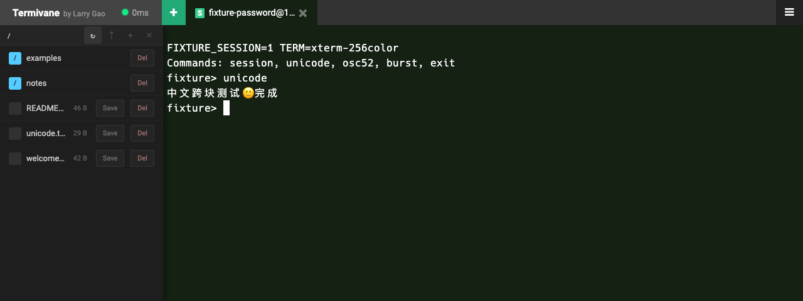

<div align="center">


# Termivane

**Your SSH workspace, in the browser.**

Persistent terminals · Built-in SFTP · Self-hosted

[](LICENSE.md)
[](go.mod)
[](#features)

**English** · [简体中文](README.zh-CN.md)

[Quick start](#quick-start) · [Deployment](docs/deployment.md) · [Architecture](docs/architecture.md) · [Contributing](CONTRIBUTING.md)

</div>

Termivane brings SSH terminals and remote file management into one browser workspace. Open multiple connections, move files alongside your terminal, and recover running sessions after a page refresh.

This is the **Larry Labs fork** of [nirui/sshwifty](https://github.com/nirui/sshwifty), with persistent sessions, integrated SFTP, and a customized terminal interface. It focuses on SSH; Telnet has been removed from this fork.

Termivane combines **terminal** and **vane**: a point of direction for remote work. The repository URL, `sshwifty` executable, `SSHWIFTY_*` settings, and browser storage keys retain their existing names for compatibility.



*Actual application running against a local, in-memory test server. No production hosts, files, or credentials are shown.*

## Features

| Capability | What it does |
| --- | --- |
| **Persistent sessions** | Keeps SSH sessions on the server and restores multiple tabs after a browser refresh. |
| **Integrated file management** | Browse directories, upload and download files, and create or delete directories from the SFTP panel. |
| **Terminal experience** | 256-color PTY, adjustable font size, Unicode streaming, and up to 999,999 lines of browser scrollback. |
| **Clipboard with consent** | OSC 52 copy requests require one-time or per-terminal permission. Permission can be revoked; remote clipboard reads are disabled. |
| **Authentication choices** | Password, private key, and keyboard-interactive authentication, including multiple challenge rounds. |
| **Connection resilience** | TCP keepalive, WebSocket heartbeats, SFTP reconnects, and adaptive upload throttling. |
| **Desktop and mobile** | Responsive terminal layout, touch controls, and persistent font preferences. |

### Session behavior

Sessions live in the server process. The current implementation has a **12-hour lifetime from session creation** and retains the **latest 64 KiB of output** for replay after refresh. Browser scrollback and server replay history are separate limits. Restarting the server ends its SSH sessions.

Password and private-key SFTP transfers use an independent SSH connection pinned to the host key accepted by the terminal. Keyboard-interactive sessions open SFTP on the existing authenticated transport, so one-time answers are not replayed.

## Quick start

### Requirements

- Go **1.27.3 or later**
- Node.js **22 or later**, with npm
- Git and Bash; Windows users can use WSL

### Build

```bash
git clone https://github.com/Larry-Labs/sshwifty.git
cd sshwifty
npm ci
npm run build
```

The build generates frontend assets, embeds them in Go, and produces `./sshwifty`.

### Run locally

```bash
# Enter a Web access password without recording it in shell history.
read -r -s -p 'Web access password: ' SSHWIFTY_SHAREDKEY
printf '\n'
export SSHWIFTY_SHAREDKEY
SSHWIFTY_LISTENINTERFACE=127.0.0.1 \
SSHWIFTY_LISTENPORT=8182 \
./sshwifty
```

Run the example in **Bash**, then open **<http://localhost:8182>**. The Web access password protects the application entrance; SSH authentication still happens separately for each remote host.

For access from another device, serve the application over **HTTPS**. Browser cryptography requires a secure context; plain HTTP is suitable for localhost, not a public deployment.

### Deploy with Docker

The repository includes a [source-build Dockerfile](Dockerfile) and a [lightweight deployment Dockerfile](Dockerfile.deploy). The lightweight path packages a locally built Linux binary:

```bash
npm run build                 # Refresh assets after source changes
./build-deploy.sh linux amd64
```

See the [deployment guide](docs/deployment.md) for image builds, Compose configuration, TLS, reverse proxies, and the ARM filename adjustment. Build a binary from your chosen checkout rather than assuming a checked-in binary matches its source.

## Configuration

Use environment variables or a JSON file selected with `SSHWIFTY_CONFIG`. The [configuration example](sshwifty.conf.example.json) describes the full configuration shape.

| Setting | Purpose |
| --- | --- |
| `SSHWIFTY_SHAREDKEY` | Web access password. An empty value disables the entrance password. |
| `SSHWIFTY_LISTENINTERFACE` | Address on which the application listens. |
| `SSHWIFTY_LISTENPORT` | HTTP or HTTPS listen port. |
| `SSHWIFTY_DIALTIMEOUT` | Outbound SSH connection timeout, in seconds. |
| `SSHWIFTY_READTIMEOUT` / `SSHWIFTY_WRITETIMEOUT` | Connection I/O timeout settings; these do not set the persistent-session lifetime. |
| `SSHWIFTY_PRESETS` | JSON-encoded connection presets. |

Configuration-file and environment loading are alternative configuration sources, not a per-field merge. See [deployment](docs/deployment.md) before combining them.

## Security and privacy

- **Verify SSH fingerprints.** Independent SFTP connections must match the key accepted for the terminal.
- **Choose password storage deliberately.** “Remember Password” saves an obfuscated value in browser local storage. It is not an encrypted vault and is readable by same-origin scripts. Avoid it on shared or untrusted browsers.
- **Treat the service as a gateway to your hosts.** It connects from the deployment server's network and keeps SSH session state in process memory. Restrict access to the application and use HTTPS.
- **Plan for updates.** This fork retains Vue 2, and dependency audit findings remain. The [integration record](docs/selective-upstream.md) records the tested dependency set and known limits; it is not a security certification.

## Development

```bash
npm ci
npm run build
npm run lint
npm run testonly
```

`testonly` runs the frontend unit tests and Go tests with the race detector. Go race tests require CGO and a supported C toolchain. `npm run dev` watches frontend assets; it does not start or restart the Go service.

The [local SSH/SFTP fixture](tests/e2e/README.md) supports browser checks without real server credentials or host filesystem access. See [CONTRIBUTING.md](CONTRIBUTING.md) for change and validation guidance.

## Documentation

- [Deployment](docs/deployment.md) — builds, configuration, reverse proxies, and HTTPS.
- [Architecture](docs/architecture.md) — terminal streams, SFTP transport, and session lifecycle.
- [Selective upstream integration](docs/selective-upstream.md) — adopted changes, verification, and compatibility limits.
- [Browser test fixture](tests/e2e/README.md) — local SSH, SFTP, Unicode, and clipboard checks.

The deployment and architecture guides are currently in Chinese; the fixture guide is in English.

## Credits and license

Based on [Sshwifty](https://github.com/nirui/sshwifty), created by [Ni Rui](https://github.com/nirui). Fork enhancements are maintained in [Larry-Labs/sshwifty](https://github.com/Larry-Labs/sshwifty).

Licensed under the **GNU Affero General Public License v3**. See [LICENSE.md](LICENSE.md). Third-party notices are listed in [DEPENDENCIES.md](DEPENDENCIES.md); dependency versions are recorded in [go.mod](go.mod) and [package-lock.json](package-lock.json).
