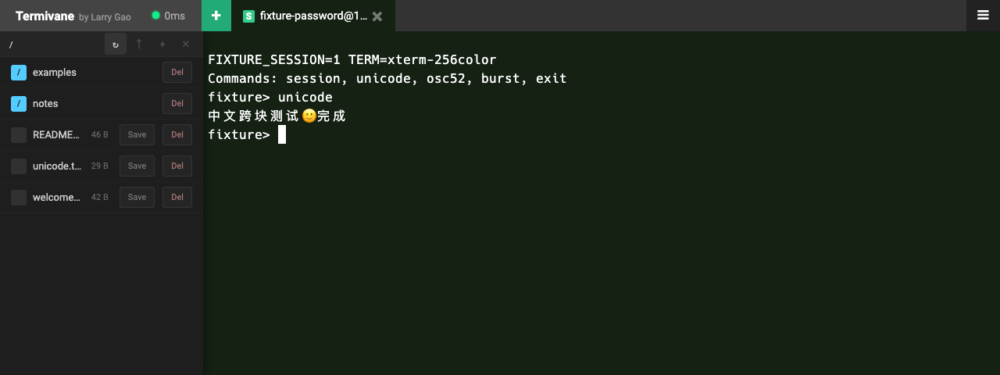

<div align="center">


# Termivane

**在浏览器中，连接终端、管理文件、继续工作。**

持久化会话 · 内置 SFTP · 自托管

[](LICENSE.md)
[](go.mod)
[](#主要功能)

[English](README.md) · **简体中文**

[快速开始](#快速开始) · [部署指南](docs/deployment.md) · [架构说明](docs/architecture.md) · [参与贡献](CONTRIBUTING.md)

</div>

Termivane 将 SSH 终端和远程文件管理放在同一个浏览器工作区中。你可以打开多个连接，在终端旁边传输文件，并在刷新页面后恢复仍然运行的会话。

这是 [nirui/sshwifty](https://github.com/nirui/sshwifty) 的 **Larry Labs 分支**，加入了持久化会话、SFTP 文件管理及终端界面定制。本分支聚焦 SSH，已移除 Telnet。

Termivane 由 **Terminal（终端）**与 **Vane（风向标）**组合而成，中文可称「终端航标」。为保持兼容，`sshwifty` 可执行文件、`SSHWIFTY_*` 配置和浏览器存储键继续沿用原名。



*截图来自实际应用和本地内存测试服务器，不包含生产主机、真实文件或凭据。*

## 主要功能

| 能力 | 说明 |
| --- | --- |
| **持久化会话** | 在服务端保持 SSH 会话，刷新浏览器后恢复多个连接标签页。 |
| **文件管理** | 在 SFTP 面板中浏览目录、上传下载文件，以及创建或删除目录。 |
| **终端体验** | 256 色 PTY、字号调节、Unicode 流式处理、最多 999,999 行浏览器滚动历史。 |
| **剪贴板授权** | 支持 OSC 52 复制，提供单次或当前终端会话授权，可随时撤销；禁止远端读取本机剪贴板。 |
| **认证方式** | 支持密码、私钥及 keyboard-interactive 交互式认证，处理多轮认证提示。 |
| **连接保活** | TCP KeepAlive、WebSocket 心跳、SFTP 自动重连与自适应上传限速。 |
| **桌面与移动端** | 响应式布局、触控操作和持久化字体偏好。 |

### 会话如何恢复

会话保存在服务进程内存中。当前实现的有效期为**自创建起 12 小时**，刷新恢复时回放**最近 64 KiB 输出**。浏览器滚动历史和服务端回放缓存是两种不同限制；服务重启会结束原有 SSH 会话。

密码和私钥模式下，SFTP 使用独立 SSH 连接，并校验终端已接受的主机密钥。交互式认证模式下，SFTP 在已认证的 SSH 连接上建立独立通道，不重放一次性验证码。

## 快速开始

### 环境要求

- Go **1.27.3 或更新版本**
- Node.js **22 或更新版本**及 npm
- Git 与 Bash；Windows 可使用 WSL

### 编译

```bash
git clone https://github.com/Larry-Labs/Termivane.git
cd Termivane
npm ci
npm run build
```

构建过程生成前端资源并嵌入 Go，最终产出 `./sshwifty`。

### 本地运行

```bash
# 交互输入 Web 访问密码，避免把密码写进 shell 历史。
read -r -s -p 'Web access password: ' SSHWIFTY_SHAREDKEY
printf '\n'
export SSHWIFTY_SHAREDKEY
SSHWIFTY_LISTENINTERFACE=127.0.0.1 \
SSHWIFTY_LISTENPORT=8182 \
./sshwifty
```

请在 **Bash** 中执行以上示例，然后打开 **<http://localhost:8182>**。Web 访问密码用于保护应用入口，每台远程主机仍需要独立完成 SSH 认证。

从其他设备访问时，请配置 **HTTPS**。浏览器加密能力需要安全上下文；普通 HTTP 适用于 localhost，不适合作为公网部署入口。

### Docker 部署

仓库提供[源码构建 Dockerfile](Dockerfile)和[轻量部署 Dockerfile](Dockerfile.deploy)。轻量部署使用本地编译的 Linux 二进制：

```bash
npm run build                 # 源码变更后先刷新前端资源
./build-deploy.sh linux amd64
```

镜像构建、Compose、TLS、反向代理和 ARM 文件名调整见[部署指南](docs/deployment.md)。请从选定的代码版本重新构建，不要假定仓库内已有二进制与当前源码一致。

## 配置

支持环境变量，或通过 `SSHWIFTY_CONFIG` 选择 JSON 配置文件。[配置示例](sshwifty.conf.example.json)提供完整结构。

| 配置项 | 用途 |
| --- | --- |
| `SSHWIFTY_SHAREDKEY` | Web 访问密码；留空会关闭入口密码验证。 |
| `SSHWIFTY_LISTENINTERFACE` | 服务监听地址。 |
| `SSHWIFTY_LISTENPORT` | HTTP 或 HTTPS 监听端口。 |
| `SSHWIFTY_DIALTIMEOUT` | 出站 SSH 连接超时，单位为秒。 |
| `SSHWIFTY_READTIMEOUT` / `SSHWIFTY_WRITETIMEOUT` | 连接 I/O 超时设置，不控制持久化会话有效期。 |
| `SSHWIFTY_PRESETS` | JSON 编码的预设连接列表。 |

配置文件与环境变量是可选的配置来源，并非逐字段合并。具体加载方式见[部署指南](docs/deployment.md)。

## 安全与隐私

- **核对 SSH 指纹。** 独立 SFTP 连接必须匹配终端已接受的主机密钥。
- **主动选择是否记住密码。** 该功能在浏览器 localStorage 中保存混淆数据，不是加密密码库，同源脚本可以读取。共享或不可信浏览器中请避免使用。
- **按远程主机访问入口管理服务。** 应用从部署服务器所在网络连接目标主机，并在进程内存中保持 SSH 会话；请限制应用访问并配置 HTTPS。
- **持续更新依赖。** 本分支保留 Vue 2，目前仍有依赖审计告警。[集成记录](docs/selective-upstream.md)说明已验证的依赖版本和已知限制，不代表安全认证。

## 开发与验证

```bash
npm ci
npm run build
npm run lint
npm run testonly
```

`testonly` 运行前端单元测试及启用 race detector 的 Go 测试；Go race 测试需要 CGO 和受支持的 C 工具链。`npm run dev` 监听前端资源变化，不会启动或重启 Go 服务。

[本地 SSH/SFTP 测试服务](tests/e2e/README.md)支持不使用真实凭据、不访问宿主机文件的浏览器验证。提交改动前请参阅[贡献指南](CONTRIBUTING.md)。

## 文档导航

- [部署指南](docs/deployment.md)：编译、配置、反向代理及 HTTPS。
- [架构说明](docs/architecture.md)：终端数据流、SFTP 传输与会话生命周期。
- [上游能力移植记录](docs/selective-upstream.md)：移植内容、验证及兼容边界。
- [浏览器测试服务](tests/e2e/README.md)：本地 SSH、SFTP、Unicode 与剪贴板验证。

部署与架构文档为中文；测试服务说明及贡献指南为英文。

## 致谢与许可证

本项目基于 [Ni Rui](https://github.com/nirui) 创建的 [Sshwifty](https://github.com/nirui/sshwifty)。分支增强功能维护于 [Larry-Labs/Termivane](https://github.com/Larry-Labs/Termivane)。

采用 **GNU Affero General Public License v3**，完整条款见 [LICENSE.md](LICENSE.md)。第三方声明见 [DEPENDENCIES.md](DEPENDENCIES.md)，依赖版本以 [go.mod](go.mod) 和 [package-lock.json](package-lock.json) 为准。
